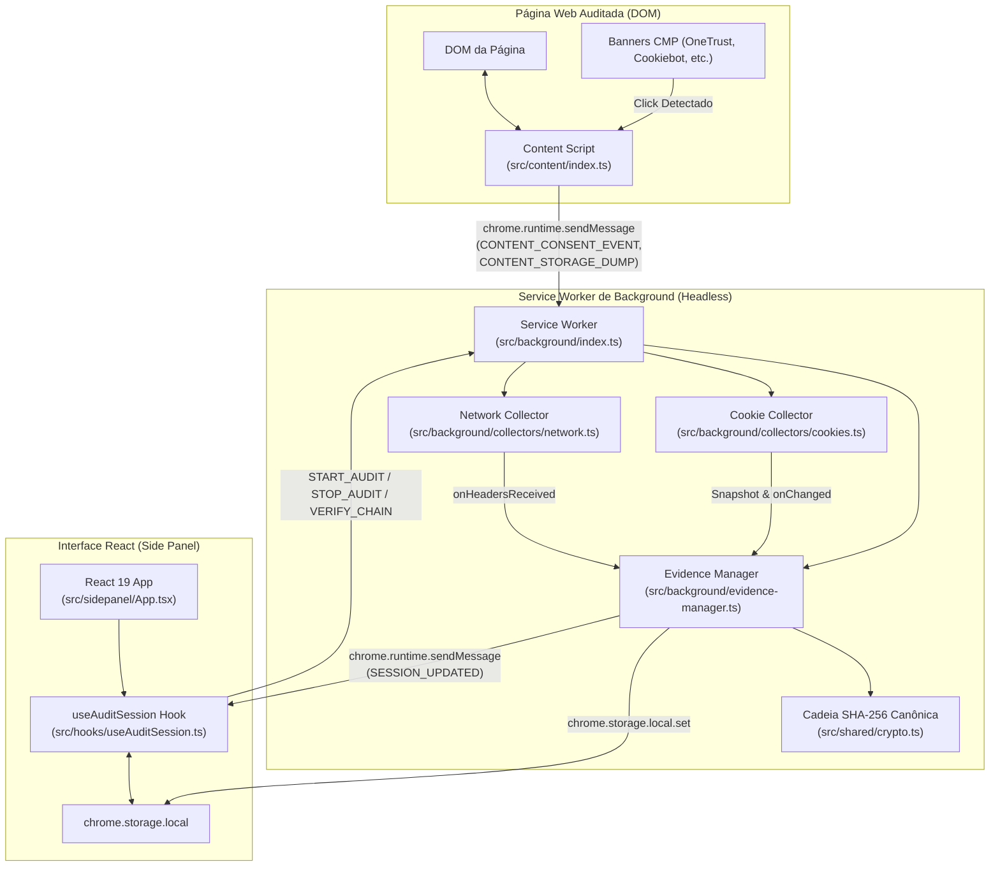

# Arquitetura Técnica — Privacylens Extension

## 1. Visão Geral

O Privacylens é estruturado em três domínios de execução isolados pelo Chrome Manifest V3:

---

## 2. Contratos de Mensagens (IPC)

As mensagens entre o Content Script, o Background e a UI React utilizam tipos TypeScript unificados definidos em [`src/shared/types.ts`](file:///home/leo/workspace/ProjectLens/lens-extension/src/shared/types.ts):

| Mensagem | Origem | Destino | Finalidade |
|---|---|---|---|
| `START_AUDIT` | React UI | Background | Inicia a sessão de auditoria para a aba atual, ativa coletores e cria o evento gênese. |
| `STOP_AUDIT` | React UI | Background | Finaliza a sessão, congela coletores e gera o evento de encerramento na cadeia. |
| `CONTENT_CONSENT_EVENT` | Content Script | Background | Notifica ação no banner (aceite, recusa, preferências, banner detectado). |
| `CONTENT_STORAGE_DUMP` | Content Script | Background | Envia snapshot das chaves e tamanhos de `localStorage` e `sessionStorage`. |
| `VERIFY_CHAIN_INTEGRITY` | React UI | Background | Recalcula todos os hashes SHA-256 da cadeia sequencialmente para verificar integridade. |
| `SESSION_UPDATED` | Background | React UI | Notifica a UI reativa quando novo evento é anexado à sessão. |

---

## 3. Modelo Criptográfico de Cadeia de Hashes

Para garantir a auditabilidade técnica sem depender de servidores remotos:
* **Canonicalização de JSON:** Todos os campos do evento têm suas chaves ordenadas alfabeticamente e de forma recursiva antes do hashing, evitando discrepâncias de serialização.
* **Algoritmo:** SHA-256 nativo via `crypto.subtle.digest` (Web Crypto API).
* **Vínculo:** O evento $N$ contém obrigatoriamente `previousHash = Hash(N-1)`.
